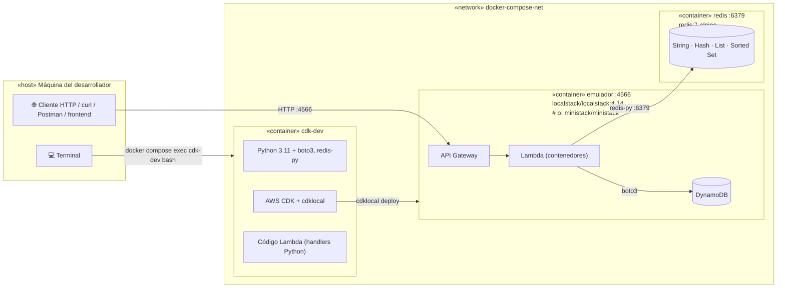
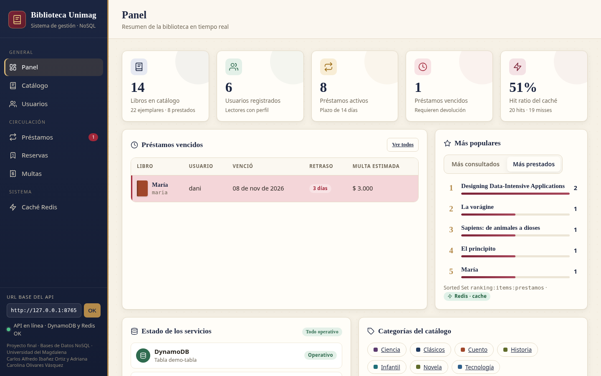
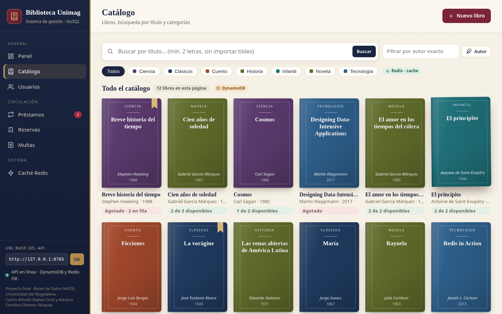
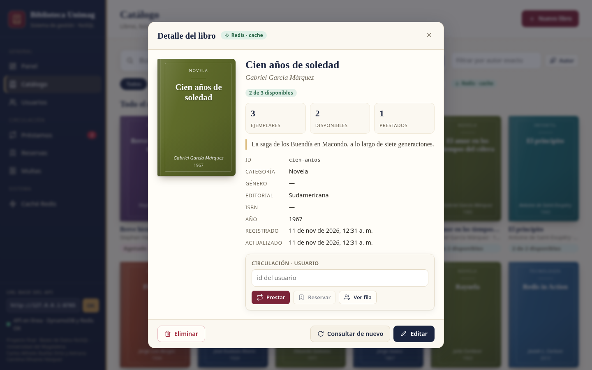
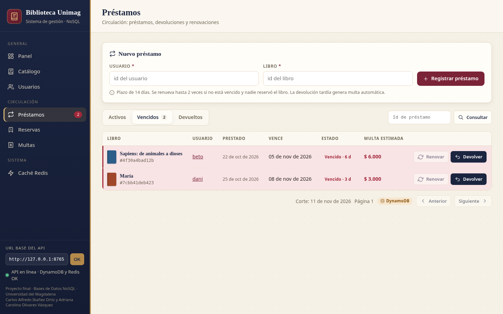
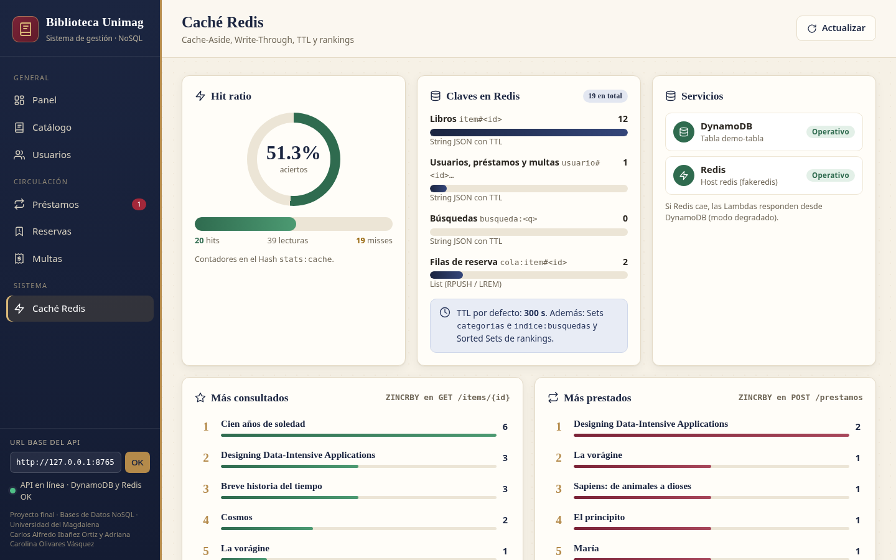

# Proyecto Final — Catálogo de biblioteca serverless (DynamoDB + Redis)

**Asignatura:** Bases de Datos NoSQL — Universidad del Magdalena  
**Integrantes:**
- Carlos Alfredo Ibañez Ortiz
- Adriana Carolina Olivares Vásquez
- Yineth Ávila Villalobos
- Albert David Peña Artunduaga
- Wilmar Arias Uribe

**Repositorio oficial del curso:** <https://gitlab.com/caov_unimag/bd_no_sql>

API REST serverless que corre **completamente en local** sobre tres
contenedores Docker: un emulador de AWS (LocalStack o MiniStack) con
**API Gateway, Lambda y DynamoDB**, un **Redis** como caché y un contenedor
de desarrollo **CDK** con Python 3.11. El dominio es la biblioteca de la
universidad: **libros** (los *ítems* del API `/items`), **categorías**,
**usuarios**, **préstamos**, **reservas** y **multas**, todos en **una sola
tabla DynamoDB**, con **27 endpoints**.

| Stack obligatorio | Dónde está |
|---|---|
| DynamoDB con Single Table Design | `app/infra/stack.py` (tabla `PK`/`SK` + `GSI1` + `GSI2` + `GSI3`), `docs/diseno.md` |
| Redis con patrones justificados | `app/lambdas/items/cache.py` (Cache-Aside, Write-Through, TTL, invalidación; String, Set, List, Sorted Set y Hash) |
| Python (Lambdas y CDK) | `app/lambdas/`, `app/infra/` |
| CDK (infraestructura como código) | `app/infra/app.py`, `app/infra/stack.py` |
| API Gateway + Lambda | `RestApi` con 27 endpoints (ver sección 4) |
| Docker Compose con emulador | `docker-compose.yml`, `Dockerfile` |
| Tests con moto + fakeredis | `app/tests/` |

El documento de diseño (access patterns, modelo de la tabla y justificación
del caché) está en [`docs/diseno.md`](docs/diseno.md). Cómo se abre la
aplicación está comentado al inicio del script de `frontend/index.html`
y en `frontend/servir.py`.

---

## 1. Arquitectura de tres contenedores



| Contenedor | Imagen | Puerto | Rol |
|---|---|---|---|
| `emulador` | `localstack/localstack:4.14` (o `ministack/ministack`) | 4566 | Simula API Gateway, Lambda y DynamoDB |
| `redis` | `redis:7-alpine` (`redis-server --appendonly yes`) | 6379 | Caché in-memory con persistencia AOF |
| `cdk-dev` | `Dockerfile` (python:3.11-slim + Node.js + aws-cdk + aws-cdk-local) | — (bash) | Escribir y desplegar la infraestructura y las Lambdas |

### ¿Cómo llegan las Lambdas a Redis?

El emulador ejecuta cada Lambda en **un contenedor aparte** que crea a través
de `/var/run/docker.sock`. Ese contenedor no pertenece al compose, así que por
defecto no resolvería el nombre `redis`. Para resolverlo:

1. La red del compose tiene un **nombre fijo**: `docker-compose-net`
   (`networks.default.name`), sin importar el nombre de la carpeta.
2. El emulador recibe `LAMBDA_DOCKER_NETWORK: docker-compose-net`, así los
   contenedores de las Lambdas se conectan a esa misma red.
3. Las Lambdas reciben `REDIS_HOST=redis` (definido en el stack CDK) y se
   conectan por nombre de servicio. Para DynamoDB, el emulador inyecta en las
   Lambdas la variable `AWS_ENDPOINT_URL` y boto3 la usa automáticamente.

### Lambda Layer `dependencias`

`app/layers/dependencias/requirements.txt` (boto3, botocore, redis) es la
fuente única de las dependencias de las Lambdas; `app/requirements.txt` la
incluye con `-r`, así desarrollo, tests y Lambdas usan las mismas versiones.
En AWS real el stack publica esas dependencias como **Lambda Layer**. En
LocalStack Community las layers se aceptan pero no se montan al ejecutar
(es una función de LocalStack Pro), por eso, cuando existe
`AWS_ENDPOINT_URL`, el stack empaqueta las dependencias dentro del código de
cada Lambda (con el `pip` del propio contenedor `cdk-dev`, sin Docker).

---

## 2. Estructura del proyecto

```
proyecto_final/
├── docker-compose.yml        # Orquestación de los 3 contenedores
├── Dockerfile                # Imagen del contenedor cdk-dev
├── .env.example              # Variables de entorno de referencia
├── README.md
├── docs/
│   ├── diseno.md             # Access patterns, Single Table Design y caché
│   └── capturas/             # Capturas del frontend
├── frontend/
│   ├── index.html            # Sistema de gestión de la biblioteca (un solo archivo)
│   └── servir.py             # Sirve la página y detecta el API en LocalStack
├── scripts/
│   └── probar_api.sh         # Recorre todos los endpoints con curl
└── app/
    ├── cdk.json              # Configuración CDK
    ├── requirements.txt      # CDK + dependencias de las Lambdas + tests
    ├── pytest.ini
    ├── infra/
    │   ├── app.py            # Punto de entrada CDK (ProyectoFinalStack)
    │   └── stack.py          # Tabla + GSI1/2/3 + layer + Lambdas + API Gateway
    ├── layers/dependencias/
    │   └── requirements.txt  # Dependencias de las Lambdas (Lambda Layer)
    ├── lambdas/
    │   ├── items/            # Lambda ItemsHandler (todas las rutas del dominio)
    │   │   ├── handler.py    # Enrutador: (método, recurso) → función
    │   │   ├── libros.py     # /items: Cache-Aside, Write-Through, búsqueda
    │   │   ├── categorias.py # /categorias: Set de Redis + GSI3
    │   │   ├── usuarios.py   # /usuarios y /usuarios/{id}/prestamos
    │   │   ├── prestamos.py  # /prestamos: transacciones, vencidos, renovación
    │   │   ├── reservas.py   # /reservas: cola en una List de Redis
    │   │   ├── multas.py     # /multas y /usuarios/{id}/multas
    │   │   ├── comun.py      # Tabla, respuestas HTTP y validaciones
    │   │   └── cache.py      # Abstracción de Redis (degraded mode, rankings, stats)
    │   └── health/
    │       └── handler.py    # Health check de DynamoDB y Redis
    └── tests/
        ├── conftest.py       # Fixtures: moto + fakeredis + helper llamar()
        ├── test_items.py     # Libros, rankings y enrutador
        ├── test_usuarios.py  # Usuarios y préstamos por usuario
        ├── test_prestamos.py # Préstamos, vencidos, renovaciones y devoluciones
        ├── test_reservas.py  # Reservas y cola de espera
        ├── test_multas.py    # Multas manuales y automáticas
        ├── test_categorias.py# Búsqueda y categorías
        ├── test_cache.py     # cache.py y GET /cache/stats
        └── test_health.py    # GET /health
```

---

## 3. Flujo de trabajo

Requisitos en la máquina: Docker y Docker Compose v2.

| Paso | Qué se hace | Comando |
|---|---|---|
| 1 | Levantar el stack | `docker compose up -d --build` |
| 2 | Entrar al contenedor de desarrollo *(los pasos 3–5 y 8 se ejecutan ahí)* | `docker compose exec cdk-dev bash` |
| 3 | Bootstrap de CDK ⚠ **repetir tras cada reinicio del emulador** | `cdklocal bootstrap` |
| 4 | Escribir infraestructura y Lambdas | `app/infra/stack.py` + handlers en `app/lambdas/` |
| 5 | Desplegar | `cdklocal deploy` |
| 6 | Probar el API | `curl` / Postman / `frontend/index.html` (ver sección 4) |
| 7 | Verificar el caché en Redis (desde el host) | `docker compose exec redis redis-cli` |
| 8 | Ejecutar los tests (moto + fakeredis, no requieren el emulador) | `python -m pytest tests/ -v` |

Comandos útiles dentro de `cdk-dev`:

```bash
cdklocal synth     # genera la plantilla CloudFormation sin desplegar
cdklocal diff      # muestra los cambios pendientes antes de desplegar
cdklocal deploy --require-approval never   # despliega sin preguntar
```

---

## 4. Probar el API

Al terminar, `cdklocal deploy` imprime el output `ApiUrl`, por ejemplo:

```
ProyectoFinalStack.ApiUrl = https://<api-id>.execute-api.localhost.localstack.cloud:4566/prod/
```

El **`api-id`** es el primer segmento del dominio (antes de `.execute-api`).
⚠ El `api-id` **cambia en cada reinicio del emulador**: revisar el `ApiUrl`
después de cada `cdklocal deploy`.

**Opción A — URL directa del `ApiUrl`** (sirve con `http` o `https`):

```
http://<api-id>.execute-api.localhost.localstack.cloud:4566/prod/health
```

`*.localhost.localstack.cloud` siempre resuelve a `127.0.0.1`. Si Postman
muestra error SSL con `https`, desactivar *Settings → SSL certificate
verification* o usar `http`.

**Opción B — `localhost` con el `api-id`** (no depende de DNS; usarla si la
opción A no responde):

```
http://localhost:4566/restapis/<api-id>/prod/_user_request_/health
```

### Endpoints (27)

| # | Método | Ruta | Descripción | Patrón / operación | Respuestas |
|---|---|---|---|---|---|
| 1 | `GET` | `/health` | Estado de DynamoDB y Redis | `DescribeTable` + `PING` | `200` · `503` |
| 2 | `POST` | `/items` | Crear libro | **Write-Through** + contador de categoría | `201` · `400` · `409` |
| 3 | `GET` | `/items` | Catálogo por título (`?limite=`, `?siguiente=`) o por autor (`?autor=`) | `Query` GSI2 / GSI1 | `200` · `400` |
| 4 | `GET` | `/items/buscar?q=` | Títulos que contienen el texto (sin mayúsculas ni tildes) | **Cache-Aside** (String + Set índice) | `200` · `400` |
| 5 | `GET` | `/items/populares` | Ranking `?por=consultas\|prestamos&n=5` | Sorted Set | `200` · `400` · `503` |
| 6 | `GET` | `/items/{id}` | Obtener libro; indica `"_fuente": "cache"` o `"dynamodb"` | **Cache-Aside** + TTL | `200` · `404` |
| 7 | `PUT` | `/items/{id}` | Actualizar campos de un libro | **Write-Through** + invalidación de búsquedas/categorías | `200` · `400` · `404` · `409` |
| 8 | `DELETE` | `/items/{id}` | Eliminar libro (sin préstamos ni reservas) | **Invalidación** | `200` · `404` · `409` |
| 9 | `GET` | `/categorias` | Nombres de las categorías con libros | **Cache-Aside** sobre un Set | `200` |
| 10 | `GET` | `/categorias/{nombre}/items` | Libros de una categoría, por título (paginado) | `Query` GSI3 | `200` · `400` · `404` |
| 11 | `POST` | `/usuarios` | Crear usuario | **Write-Through** | `201` · `400` · `409` |
| 12 | `GET` | `/usuarios` | Listar usuarios por nombre (paginado) | `Query` GSI2 | `200` · `400` |
| 13 | `GET` | `/usuarios/{id}` | Obtener usuario | **Cache-Aside** + TTL | `200` · `404` |
| 14 | `PUT` | `/usuarios/{id}` | Actualizar nombre, email o programa | `UpdateItem` + **Write-Through** | `200` · `400` · `404` |
| 15 | `DELETE` | `/usuarios/{id}` | Eliminar usuario, préstamos y multas (sin préstamos activos ni reservas) | **Invalidación** | `200` · `404` · `409` |
| 16 | `GET` | `/usuarios/{id}/prestamos` | Préstamos del usuario (`?estado=activo\|devuelto`) | `Query` por PK + **Cache-Aside** | `200` · `400` · `404` |
| 17 | `GET` | `/usuarios/{id}/multas` | Multas del usuario y saldo pendiente | `Query` por PK + **Cache-Aside** | `200` · `404` |
| 18 | `POST` | `/prestamos` | Prestar un libro (14 días) | Transacción + **invalidación** + `ZINCRBY` | `201` · `400` · `404` · `409` |
| 19 | `GET` | `/prestamos?estado=` | Préstamos `activo` (por defecto) o `devuelto`, por fecha límite (paginado) | `Query` GSI3 | `200` · `400` |
| 20 | `GET` | `/prestamos/vencidos` | Préstamos activos con fecha límite pasada, con días de retraso y multa estimada | `Query` GSI3 por rango | `200` |
| 21 | `GET` | `/prestamos/{id}` | Obtener préstamo | `Query` GSI1 | `200` · `404` |
| 22 | `PUT` | `/prestamos/{id}/devolver` | Devolver el libro; multa automática si hay retraso | Transacción + **invalidación** | `200` · `404` · `409` |
| 23 | `PUT` | `/prestamos/{id}/renovar` | +14 días; máx. 2 veces; no vencido; sin reservas del libro | Transacción + **invalidación** | `200` · `404` · `409` |
| 24 | `POST` | `/reservas` | Reservar un libro sin ejemplares libres; responde la `posicion` en la fila | Transacción + `RPUSH` (List) | `201` · `400` · `404` · `409` |
| 25 | `DELETE` | `/reservas/{id}` | Cancelar la reserva | Transacción + `LREM` | `200` · `404` |
| 26 | `POST` | `/multas` | Registrar una multa manual | Transacción + **invalidación** | `201` · `400` · `404` |
| 27 | `GET` | `/cache/stats` | Hits, misses, *hit ratio* y claves en Redis | Hash + `SCAN` | `200` · `503` |

Los endpoints 1, 2, 6 y 8 son los que pide la presentación; el resto amplía
el dominio en la misma tabla. Todas las peticiones con body (`POST`, `PUT`)
deben enviar `Content-Type: application/json`; si no, responden `400`. En
Postman basta con elegir **Body → raw → JSON**.

> Rutas fijas y rutas con `{id}`: `/items/buscar`, `/items/populares` y
> `/prestamos/vencidos` son recursos propios en API Gateway, distintos de
> `/items/{id}` y `/prestamos/{id}`. La Lambda enruta por el recurso que
> llega en el evento, así que `GET /items/buscar` nunca se interpreta como el
> libro con id `buscar`.

Campos:

- **Libro**: `titulo` y `autor` (obligatorios), `id` (opcional; letras,
  números, `-` y `_`), `categoria`, `anio` (entero), `isbn`, `genero`,
  `editorial`, `descripcion` (texto) y `ejemplares` (entero ≥ 0, por defecto
  1). La respuesta agrega `disponibles`, `prestados`, `reservas_pendientes` y
  `disponible`.
- **Usuario**: `nombre` y `email` (obligatorios), `id` y `programa`
  (opcionales). Máximo 3 préstamos activos. La respuesta incluye
  `prestamos_activos` y `saldo_multas`.
- **Préstamo**: `usuario_id` e `item_id`. Plazo 14 días; cada renovación suma
  14 días a la fecha límite.
- **Reserva**: `usuario_id` e `item_id`. Solo para libros sin ejemplares
  libres; cuando se devuelve un ejemplar, solo los primeros de la fila pueden
  llevárselo y el préstamo consume su reserva.
- **Multa**: `usuario_id`, `monto` (entero, en pesos) y `motivo`
  (obligatorios), `prestamo_id` (opcional, debe ser del mismo usuario). Las
  devoluciones tardías generan multas automáticas de 1000 por día.

### Ejemplos con curl (opción B)

```bash
API=http://localhost:4566/restapis/<api-id>/prod/_user_request_
JSON='Content-Type: application/json'

# 1. Health check
curl $API/health

# 2. Crear libros (quedan en DynamoDB y en Redis con TTL de 300 s)
curl -X POST -H "$JSON" \
     -d '{"id":"cien-anios","titulo":"Cien años de soledad","autor":"Gabriel García Márquez","anio":1967,"categoria":"Novela","ejemplares":1}' \
     $API/items
curl -X POST -H "$JSON" \
     -d '{"id":"cosmos","titulo":"Cosmos","autor":"Carl Sagan","anio":1980,"categoria":"Ciencia"}' \
     $API/items

# 3. Catálogo (paginado) y libros de un autor
curl "$API/items?limite=10"
curl -G $API/items --data-urlencode "autor=Gabriel García Márquez"

# 4. Buscar por título (la segunda vez responde "_fuente": "cache")
curl -G $API/items/buscar --data-urlencode "q=años"

# 5. Libros más consultados y más prestados
curl "$API/items/populares?por=consultas&n=5"
curl "$API/items/populares?por=prestamos&n=5"

# 6. Obtener un libro ("_fuente": "cache" o "dynamodb")
curl $API/items/cien-anios

# 7. Actualizar un libro (Write-Through)
curl -X PUT -H "$JSON" -d '{"genero":"Realismo mágico"}' $API/items/cien-anios

# 9. Categorías y 10. libros de una categoría
curl $API/categorias
curl $API/categorias/Novela/items

# 11. Crear usuarios, 12. listarlos, 13. obtener uno y 14. actualizarlo
curl -X POST -H "$JSON" -d '{"id":"ana","nombre":"Ana Pérez","email":"ana@unimag.edu.co"}' $API/usuarios
curl -X POST -H "$JSON" -d '{"id":"beto","nombre":"Beto Díaz","email":"beto@unimag.edu.co"}' $API/usuarios
curl "$API/usuarios?limite=10"
curl $API/usuarios/ana
curl -X PUT -H "$JSON" -d '{"programa":"Ingeniería de Sistemas"}' $API/usuarios/ana

# 18. Prestar (la respuesta trae el "id" del préstamo)
curl -X POST -H "$JSON" -d '{"usuario_id":"ana","item_id":"cien-anios"}' $API/prestamos

# 19. Préstamos por estado, 20. vencidos y 21. uno por id
curl "$API/prestamos?estado=activo"
curl $API/prestamos/vencidos
curl $API/prestamos/<prestamo-id>

# 23. Renovar (+14 días)
curl -X PUT $API/prestamos/<prestamo-id>/renovar

# 24. Reservar el libro agotado (responde "posicion" en la fila) y 25. cancelar
curl -X POST -H "$JSON" -d '{"usuario_id":"beto","item_id":"cien-anios"}' $API/reservas
curl -X DELETE $API/reservas/<reserva-id>

# 16. Préstamos del usuario
curl "$API/usuarios/ana/prestamos?estado=activo"

# 22. Devolver (si está vencido genera una multa automática)
curl -X PUT $API/prestamos/<prestamo-id>/devolver

# 26. Registrar una multa y 17. ver las multas del usuario
curl -X POST -H "$JSON" -d '{"usuario_id":"ana","monto":5000,"motivo":"Libro dañado"}' $API/multas
curl $API/usuarios/ana/multas

# 27. Estadísticas del caché
curl $API/cache/stats

# Errores de validación → 400
curl -X POST -H "$JSON" -d '{malo' $API/items
curl -X POST -H "$JSON" -d '{"titulo":"Sin autor"}' $API/items

# 8. Eliminar un libro y 15. un usuario
curl -X DELETE $API/items/cosmos
curl -X DELETE $API/usuarios/beto
```

El script `scripts/probar_api.sh <api-id>` (ejecutado en el host, desde la
carpeta del proyecto) recorre los 27 endpoints en orden, muestra la cola de
reservas y las claves de Redis con `redis-cli`, y fuerza un *miss* para
mostrar el cambio de `"_fuente": "dynamodb"` a `"cache"`.

> 💡 En Postman, crear una variable `baseUrl` con la URL base y usar
> `{{baseUrl}}/health`, `{{baseUrl}}/items`, etc. Cuando cambie el `api-id`
> solo hay que actualizar la variable.

### Frontend: sistema de gestión de la biblioteca

`frontend/index.html` es la aplicación de circulación (un solo archivo, sin
dependencias ni CDN). No se abre como archivo: hay que servirla con
`frontend/servir.py`, que además detecta sola el API desplegado en LocalStack.
El comentario al inicio del script de `index.html` dice cómo abrirla.

| Sección | Qué hace |
|---------|----------|
| Inicio | Resumen del día, accesos rápidos, filas de espera y lo más leído |
| Catálogo | Búsqueda, filtros de disponibilidad y ficha del libro |
| Usuarios | Alta y ficha con préstamos y multas |
| Préstamos | Prestar, devolver, renovar; en curso, vencidos y devueltos |
| Reservas | Tablero de filas de los libros agotados |
| Multas | Multa manual y saldo de un usuario |
| Sistema | Salud de DynamoDB y Redis; el modo técnico muestra el origen de cada dato |







Las capturas se tomaron con Chrome sin interfaz y datos de ejemplo, ejecutando
las Lambdas del proyecto con moto y fakeredis detrás de un servidor HTTP local.
La interfaz de circulación (filtros, filas y modo técnico) es posterior a
esas imágenes.

## 5. Verificar el caché con redis-cli

```bash
docker compose exec redis redis-cli
```

```
KEYS '*'                                   # ver todas las claves (solo en desarrollo)
GET item#cien-anios                        # JSON del libro en caché
TTL item#cien-anios                        # segundos que le quedan (≤ 300)
GET usuario#ana#prestamos                  # préstamos del usuario en caché
ZREVRANGE ranking:items:consultas 0 4 WITHSCORES   # más consultados
ZREVRANGE ranking:items:prestamos 0 4 WITHSCORES   # más prestados
HGETALL stats:cache                        # hits y misses
SMEMBERS categorias                        # Set de categorías en caché
SMEMBERS indice:busquedas                  # búsquedas cacheadas
GET "busqueda:ANOS"                        # resultado de buscar "años"
LRANGE cola:item#cien-anios 0 -1           # fila de reservas (List)
GET usuario#ana#multas                     # multas del usuario en caché
DEL item#cien-anios                        # fuerza un miss en el próximo GET
```

Secuencia para demostrar Cache-Aside:

1. `DEL item#cien-anios` en `redis-cli`.
2. `GET /items/cien-anios` → `"_fuente": "dynamodb"` (miss: lee DynamoDB y
   ejecuta `SETEX item#cien-anios 300 …`).
3. `GET /items/cien-anios` otra vez → `"_fuente": "cache"` (hit).
4. `TTL item#cien-anios` → un valor entre 1 y 300.

Secuencia para demostrar la invalidación: después de `POST /prestamos`,
`EXISTS item#cien-anios` responde `0`, y el siguiente `GET /items/cien-anios`
trae desde DynamoDB el stock actualizado (`disponibles` menor).

---

## 6. Tests

Dentro de `cdk-dev` (`/app`):

```bash
python -m pytest tests/ -v
```

Los tests usan **moto** (DynamoDB en memoria, con el mismo esquema `PK`/`SK`
+ `GSI1` + `GSI2` + `GSI3` del stack) y **fakeredis**, por lo que corren
**sin el emulador**. `conftest.py` elimina `AWS_ENDPOINT_URL` para que boto3
no escriba en el emulador real, ofrece el helper `llamar()` que arma el
evento de API Gateway y el fixture `viajar_en_el_tiempo` que cambia la fecha
"de hoy" para probar vencimientos, renovaciones y multas. Hay tests para
**cada uno de los 27 endpoints**:

| Archivo | Qué cubre |
|---|---|
| `test_health.py` | `GET /health`: 200 con todo arriba; 503 si Redis o la tabla fallan |
| `test_items.py` | `POST`, `GET`, `PUT`, `DELETE /items…`, `GET /items` (GSI2, GSI1, paginación), `GET /items/populares`; Write-Through con TTL; Cache-Aside miss → `"dynamodb"`, hit → `"cache"` (sin tocar DynamoDB); expiración; invalidación; validaciones 400; 404, 405, 409; modo degradado; error de DynamoDB → 500; enrutador con 26 rutas |
| `test_categorias.py` | `GET /items/buscar` (sin tildes ni mayúsculas, Cache-Aside, Set índice, invalidación al crear/editar/borrar libros), `GET /categorias` (Set con TTL, contadores, invalidación), `GET /categorias/{nombre}/items` (GSI3, paginación, URL encoding); `/items/buscar` no se confunde con `/items/{id}` |
| `test_usuarios.py` | `POST`, `GET`, `PUT`, `DELETE /usuarios…`, `GET /usuarios` (GSI2, paginación) y `GET /usuarios/{id}/prestamos` |
| `test_prestamos.py` | `POST /prestamos` (transacción, sin ejemplares, máximo, 404), `GET /prestamos?estado=`, `GET /prestamos/vencidos`, `GET /prestamos/{id}`, `PUT …/devolver`, `PUT …/renovar` (+14 días, máximo 2, vencido, con reservas) |
| `test_reservas.py` | `POST /reservas` (List en orden, posición, reconstrucción de la cola), `DELETE /reservas/{id}` (`LREM`), solo el primero de la fila puede prestar, Redis caído |
| `test_multas.py` | `POST /multas`, `GET /usuarios/{id}/multas` (Cache-Aside, saldo), multa automática por devolución tardía |
| `test_cache.py` | `cache.py` (get/set/delete, TTL 300 por defecto, rankings, stats, Redis caído) y `GET /cache/stats` |

---

## 7. Elegir emulador

Solo cambia la línea `image:` del servicio `emulador` en `docker-compose.yml`.
El nombre del servicio (`emulador`), el puerto 4566 y
`AWS_ENDPOINT_URL=http://emulador:4566` son iguales en ambas opciones.

```yaml
# Opción A — LocalStack (4.14: última versión gratuita sin LOCALSTACK_AUTH_TOKEN)
image: localstack/localstack:4.14
# Opción B — MiniStack (más ligero)
image: ministack/ministack
```

## 8. Variables de entorno

| Variable | Valor | Descripción |
|---|---|---|
| `AWS_ENDPOINT_URL` | `http://emulador:4566` | Redirige boto3 y cdklocal al emulador |
| `AWS_ENDPOINT_URL_S3` | `http://s3.localhost.localstack.cloud:4566` | S3 para los assets de `cdklocal` |
| `REDIS_HOST` | `redis` | Nombre del servicio Redis en la red |
| `REDIS_PORT` | `6379` | Puerto de Redis |
| `REDIS_TTL` | `300` | TTL de cada libro en caché (segundos) |
| `AWS_DEFAULT_REGION` | `us-east-1` | Región simulada |
| `AWS_ACCESS_KEY_ID` / `AWS_SECRET_ACCESS_KEY` | `test` | Credenciales dummy para el emulador |
| `MAX_PRESTAMOS` | `3` | Préstamos activos permitidos por usuario |
| `DIAS_PRESTAMO` | `14` | Plazo de devolución y de cada renovación |
| `MAX_RENOVACIONES` | `2` | Renovaciones por préstamo |
| `MULTA_POR_DIA` | `1000` | Multa automática por día de retraso |
| `TABLE_NAME` | asignado por CDK | Nombre real de la tabla (output `TableName`) |
| `LAMBDA_DOCKER_NETWORK` | `docker-compose-net` | Red a la que se conectan los contenedores de las Lambdas |

---

## 9. Para recordar

1. **Tres contenedores con responsabilidades separadas:** LocalStack o
   MiniStack simulan AWS, Redis provee el caché y `cdk-dev` es el entorno de
   desarrollo.
2. **`cdklocal`** redirige el despliegue al emulador elegido
   (LocalStack 4.14 o MiniStack); solo cambia la imagen Docker.
3. **`AWS_ENDPOINT_URL=http://emulador:4566`** y **`REDIS_HOST=redis`**
   conectan las Lambdas con el emulador y con Redis.
4. **El `api-id` cambia en cada reinicio del emulador:** revisar el `ApiUrl`
   tras cada `cdklocal deploy` (y repetir `cdklocal bootstrap`).
5. **Los tests usan moto y fakeredis:** corren sin el emulador activo.

> DynamoDB es la fuente de verdad; Redis es la velocidad.

## 10. Solución de problemas

| Síntoma | Causa probable / solución |
|---|---|
| El emulador sale con código 55 | Se usó una imagen de LocalStack posterior a 4.14; fijar `localstack/localstack:4.14`. |
| `cdklocal deploy` falla tras reiniciar el emulador | Falta el bootstrap: `cdklocal bootstrap` y luego `cdklocal deploy`. |
| `/health` responde 503 con `redis.estado = "error"` | La Lambda no llega a Redis: revisar que la red se llame `docker-compose-net` (`docker network ls`) y que `LAMBDA_DOCKER_NETWORK` tenga ese mismo valor. |
| La opción A no responde | Usar la opción B (`http://localhost:4566/restapis/<api-id>/prod/_user_request_/...`). |
| `cdklocal deploy` falla al agregar índices sobre una tabla ya desplegada | CloudFormation solo agrega un GSI por actualización. Con el emulador basta reiniciarlo (o `cdklocal destroy`), repetir `cdklocal bootstrap` y desplegar de nuevo. |
| `POST` responde 400 "Content-Type" | Enviar `-H "Content-Type: application/json"` (en Postman: Body → raw → JSON). |
| El frontend dice «Sin conexión» o la detección falla | Abrir la página con `python servir.py` desde `frontend/` (puerto 8765). `python -m http.server` y abrir el HTML como archivo no pueden listar las API de LocalStack. El motivo está comentado en `frontend/servir.py` y al inicio de `frontend/index.html`. |
| La primera consulta al catálogo tarda o se queda en «Cargando…» | LocalStack está creando el contenedor de la Lambda `ItemsHandler`. Las siguientes peticiones usan ese contenedor y responden enseguida. |

## Créditos

Carlos Alfredo Ibañez Ortiz, Adriana Carolina Olivares Vásquez, Yineth Ávila Villalobos,
Albert David Peña Artunduaga y Wilmar Arias Uribe.
Basado en el proyecto base del curso
([gitlab.com/caov_unimag/bd_no_sql](https://gitlab.com/caov_unimag/bd_no_sql)).
